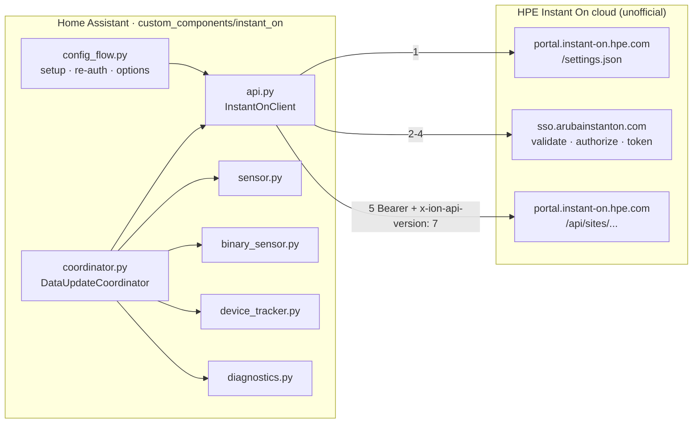
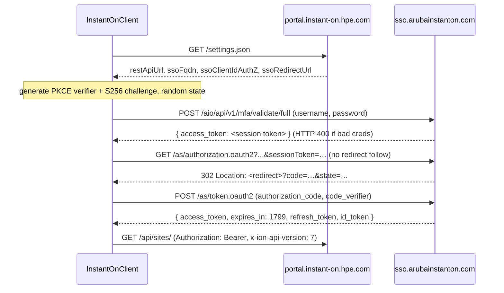

# Architecture

This document explains how the `instant_on` integration is put together, for contributors and anyone reviewing the code.

## Overview



The integration follows the standard Home Assistant **hub + coordinator** pattern:

- **One config entry per Instant On account.** The entry stores the email, password and selected site IDs.
- **One `DataUpdateCoordinator` per entry.** All entities read from it, so each poll is a single batch of API calls, however many entities exist.
- **Entities never call the API.** They only read from `coordinator.data`.

## Files

| File | Responsibility |
|---|---|
| `api.py` | Async `aiohttp` client: discovery, PKCE sign-in, token cache, authenticated GETs. Has no Home Assistant imports, so it can be tested on its own. |
| `const.py` | Constants and small pure helpers (`client_mac`, `client_name`, `is_wireless`, `is_online`). |
| `coordinator.py` | Polls sites, then clients and inventory for each site in parallel. Converts API errors into `ConfigEntryAuthFailed` or `UpdateFailed`. |
| `__init__.py` | Sets up and unloads the entry. Creates a dedicated `ClientSession` (its own cookie jar) and reloads the entry when options change. |
| `config_flow.py` | `user` step (credentials) → `sites` step (multi-select), `reauth_confirm`, and the options flow. |
| `entity.py` | `InstantOnEntity` base class and `DeviceInfo` builders for sites and network devices. |
| `sensor.py` | Per-site count/health sensors plus throughput and top-client sensors. |
| `traffic.py` | Pure helpers to read throughput and byte counters from `clientSummary` records. |
| `binary_sensor.py` | One connectivity sensor per inventory device. |
| `device_tracker.py` | One `ScannerEntity` per client MAC. New clients are added as they appear. Created disabled by default. |
| `diagnostics.py` | Dumps the coordinator data with credentials and personal fields redacted. |

## Authentication



Notes:

- **Discovery first.** Hostnames and the OAuth client ID come from `settings.json` and are never hard-coded, so a portal migration
  (like the earlier move from `portal.arubainstanton.com`) keeps working.
- **Token lifetime.** Tokens are cached until `expires_in - 60 s`. The `refresh_token` is not used yet; signing in again costs 3 requests about
  every 30 minutes. Using the refresh token is a possible improvement.
- **Concurrency.** `asyncio.Lock` around the token check means requests running in parallel trigger only one sign-in.
- **401 handling.** On a 401, the token is marked expired and the request is retried once. A second 401 raises `InstantOnAuthError`.
- **Isolation.** The client has its own `ClientSession`, so SSO cookies never leak into Home Assistant's shared session.

## Polling and data model

Each update (default every 60 s, configurable from 30 to 3600 s):

```
GET /api/sites/                              -> filter to selected site IDs
for each site (sites in sequence; the two calls per site in parallel):
    GET /api/sites/{id}/clientSummary        -> SiteData.clients  (dict keyed by lower-case MAC)
    GET /api/sites/{id}/inventory            -> SiteData.inventory
```

`coordinator.data` is `dict[site_id, SiteData]`, where `SiteData.site` is the raw site record. The site record already includes
`activeAlertsCount`, `activeAlertsCounters`, `latestActiveAlert`, `health` and `currentHealthScore`, so `/alerts` is not polled.

### Rules from live data

| Rule | Why |
|---|---|
| Connected means `status == "up"` | `clientSummary` also lists recently-seen clients with `status: "down"` |
| Wired or wireless comes from `clientType` | Falls back to `wirelessNetworkId` being set |
| Clients and devices are keyed by MAC | `id` equals the MAC for both clients and inventory devices |
| `ipAddress` may be `""` | Most wired clients report no IP |

## Entity lifecycle

- **Sensors and binary sensors** are created at setup from the first refresh. New network devices show up after a reload.
- **Device trackers** listen to the coordinator and add a `ClientTracker` the first time a MAC is seen. A tracker stays registered when its client leaves
  the list and reports `not_home`. It keeps the last known name and attributes.
- **Device registry**: each site is a device. Each AP or switch is a device linked to its site (`via_device`), with a MAC connection
  so it can merge with other integrations (DHCP, UniFi and so on) that know the same MAC.

## Error handling

| Failure | Result |
|---|---|
| Bad credentials or MFA on (sign-in) | `InstantOnAuthError` → `ConfigEntryAuthFailed` → Home Assistant starts the re-auth flow |
| Network error, 5xx, unexpected 4xx | `InstantOnError` / `OSError` / `TimeoutError` → `UpdateFailed` → entities become unavailable, retried next interval |
| Fails during the first refresh | `ConfigEntryNotReady`: Home Assistant retries setup with backoff |
| Client disappears from the list | Tracker → `not_home` (stays available) |

## Security

- The account's credentials are stored in the config entry, like most integrations. Hence the requirement for a dedicated, view-only account.
- Diagnostics redact `username`, `password`, `macAddress`, `mac`, `ipAddress`, `serialNumber`, `hostName` and `name`.
- The integration only makes GET requests to the REST API, so it can't change your network.

## Possible future work

- Use `refresh_token` instead of signing in again in full
- Per-device sensors (uptime, PoE power, radio channel and utilization)
- Pick up new network devices without a reload
- Write actions (block a client, toggle an SSID, power-cycle a PoE port), which need an admin account and request mapping
- Unit tests with recorded fixtures (`pytest-homeassistant-custom-component`)
